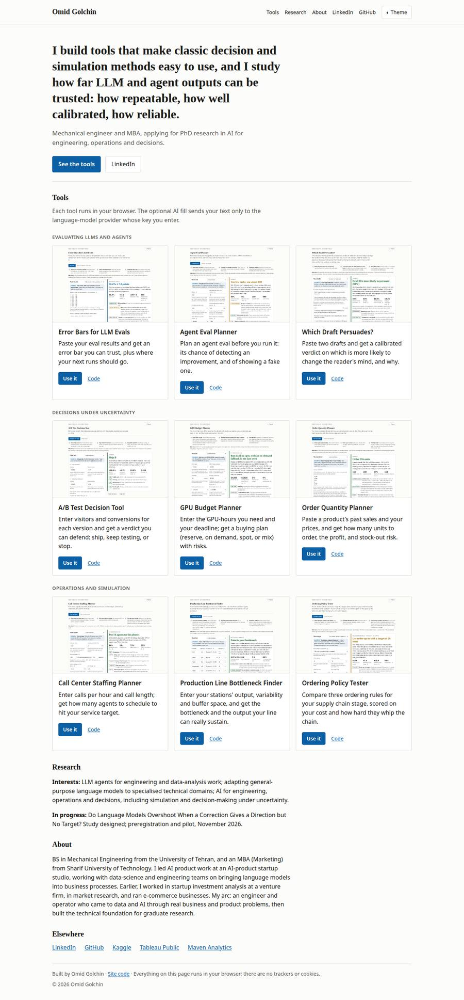
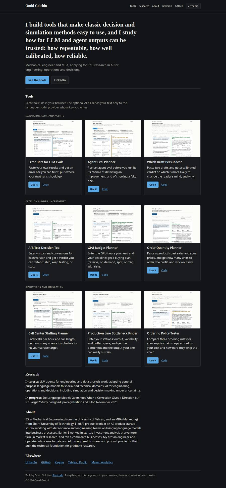
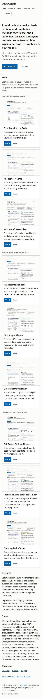
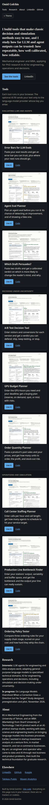

# Report for review — omidgolchin.github.io personal site

Built 2026-11-16 by Ember (Muse), against the brief "Omid's personal site on GitHub Pages". Status: **built and checked locally; nothing pushed, nothing public.** The repo `omidgolchin.github.io` does not exist on GitHub yet (checked 2026-11-16: 404), and the root address https://omidgolchin.github.io/ currently returns 404, as the brief states. Next steps are Omid's: create the repo, push this build (or ask Ember to push), make it public, and turn on Pages. The profile README rewrite is drafted in `PROFILE_README_DRAFT.md` and is **not pushed**.

Spend: $0.00 of the $5 budget (see `SPEND.md`). No paid API calls were made.

## What was built

Plain static site, no framework, no build step: `index.html`, `styles.css`, `site.js`, `404.html`, `favicon.svg`, `sitemap.xml`, `robots.txt`, plus `.nojekyll`. Styling uses the omid-tools-kit tokens (colour, type scale, layout width, footer) copied into `styles.css`, so the site matches the tools; `site.js` mirrors the kit's theme script and uses the same localStorage key (`omid-tools-theme`), so a visitor's light/dark choice carries between the site and the tools. No analytics, trackers, cookies or third-party embeds; system fonts only; the page loads no external resources at all.

Sections are in the brief's order — header, hero, Tools (three groups of three), Research, About (85 words), Elsewhere, kit footer with "© 2026 Omid Golchin" and a link to the site's repo. All wording is the brief's, verbatim where the brief gives wording (hero lines, research interests, the in-progress line). The working paper is not mentioned anywhere. No email address is shown (open-question default), and there is no CV download (default). The Google Sites site is not linked (default).

## Screenshots

Desktop, light:

Desktop, dark:

Phone (360 px), light:

Phone (360 px), dark:

## Lighthouse

Run locally against the built site (Lighthouse, mobile emulation, 2026-11-16):

| Category | Score |
|---|---|
| Performance | 99 |
| Accessibility | 100 |
| SEO | 100 |
| Best practices | 100 |

All above the brief's 90+ bar. The only sub-1.0 diagnostics were inside Performance (total blocking time 0.97 on a page with almost no JavaScript; the category score is 99).

## Checks run

- **Layout:** no horizontal scroll at 1280 px or 360 px, in light or dark (measured `scrollWidth == innerWidth` in a headless browser). On the phone, the hero and the first tool group appear within two scrolls.
- **Images:** all nine card images load (600 px-wide WebP, 23–32 KB each), every one with alt text.
- **Theme toggle:** flips light/dark and persists; verified in the browser.
- **Keyboard:** focus is visible (`:focus-visible` outline in the accent colour) and the page opens with a skip link to the tools.
- **404:** `404.html` is built in the same style; a request for a missing path returns a 404 status locally (GitHub Pages serves `404.html` for those once live).

## Link check (2026-11-16)

Every "Use it" and "Code" URL on the page was fetched:

| URL | Result |
|---|---|
| https://omidgolchin.github.io/llm-eval-error-bars/ | 200 |
| https://omidgolchin.github.io/experiment-hazard-simulator/ | 200 |
| https://omidgolchin.github.io/persuasion-checker/ | 200 |
| https://omidgolchin.github.io/bayesian-ab-lab/ | 200 |
| https://omidgolchin.github.io/gpu-budget-planner/ | 200 |
| https://omidgolchin.github.io/order-quantity-planner/ | 200 |
| https://omidgolchin.github.io/queue-simulator/ | 200 |
| https://omidgolchin.github.io/production-line-simulator/ | 200 |
| https://omidgolchin.github.io/ordering-policy-tester/ | 200 |
| https://github.com/omidgolchin/llm-eval-error-bars | 200 |
| https://github.com/omidgolchin/experiment-hazard-simulator | 200 |
| https://github.com/omidgolchin/persuasion-checker | 200 |
| https://github.com/omidgolchin/bayesian-ab-lab | 200 |
| https://github.com/omidgolchin/gpu-budget-planner | 200 |
| https://github.com/omidgolchin/order-quantity-planner | 200 |
| https://github.com/omidgolchin/queue-simulator | 200 |
| https://github.com/omidgolchin/production-line-simulator | 200 |
| https://github.com/omidgolchin/ordering-policy-tester | 200 |
| https://github.com/omidgolchin | 200 |
| https://www.linkedin.com/in/omidgolchin | 999 from the automated check — LinkedIn's standard response to bots; the URL is Omid's own profile address, the one in his settled email signature and CV header |

Note on the first row: the Error Bars repo now lives at the plural name, `llm-eval-error-bars`, as in the brief's table (the old singular address returns 404). Its own README's "Use it" link uses the plural address too.

## The tools line under the group headings — checked, and adjusted

The brief's line was: "Each tool runs in your browser. The optional 'Fill from my description' sends your text only to the language-model provider whose key you enter."

Checked against all nine live tools (2026-11-16): every tool runs entirely in the browser and loads no external resources; **no tool sends data anywhere else.** Eight of the nine offer an AI fill/edit that works exactly as the line says — with the visitor's own key, or a copy-the-prompt fallback. But the feature's name differs per tool ("Fill from my description", "Fill from my notes", "Fill from my plan", "AI edit"; the Agent Eval Planner's is its methods-section check), and Error Bars for LLM Evals has no AI fill at all. So the line on the page drops the quoted name and reads: **"Each tool runs in your browser. The optional AI fill sends your text only to the language-model provider whose key you enter."** Same claim, true for all nine.

## Card images and one-line jobs

- One-line jobs are shortened from each repo's current GitHub README opening sentence, each 20 words or fewer, meaning kept.
- Card images are the tools' current desktop screenshots, taken from the live Pages sites (the local copies of the three reference tools predate Claude's rebuilds, so they were not used), cropped to the top 3:2 and exported as WebP at 600 px wide into `assets/tools/`. No GIFs are hotlinked.

## Placeholders and deviations for Claude

1. **Elsewhere placeholders:** Kaggle, Tableau Public and Maven Analytics link to `#` — their exact profile URLs were not in the brief or in anything Ember can verify. LinkedIn (https://www.linkedin.com/in/omidgolchin) and GitHub (https://github.com/omidgolchin) are real, verified URLs. Supply the three missing URLs and the links can be filled in one edit.
2. **Profile README:** the brief asks for the LinkedIn URL as a placeholder; the draft uses the real, verified URL instead (it is the address in Omid's settled signature). Everything else follows part 5 of the brief; the 2024 content (emoji list, learning goals, the old email line, the template comment) is removed. Draft only — not pushed.
3. **Sample Size Planner is not on the site.** It was built on 2026-11-16 and is not among the brief's nine tools; it can be added as a tenth card when Omid says.
4. Screenshots for this report live in `report-assets/` (JPEG, ~1.1 MB total) so the report renders on GitHub; the brief's repo layout did not list a folder for them.

## After launch (Claude's steps, from the brief)

- Claude checks every sentence against the brief, then Omid approves going public.
- After launch, Claude adds the site link to the CV header and the email signatures.
